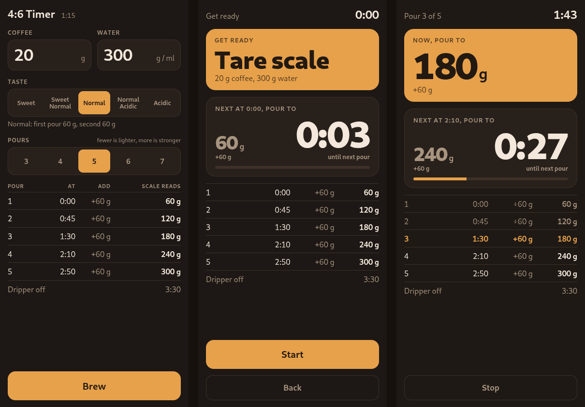

# 4:6 Timer

A pour-over timer for Tetsu Kasuya's 4:6 method. It runs in any phone browser, works offline once loaded, and has no ads, accounts or tracking. Use the hosted copy or run your own in a minute.

**Open it:** https://qwertymcqwertz.github.io/four-six/



## What it does

- Type the coffee or the water and the other fills in at 1:15.
- Pick a taste (five steps from sweet to acidic) and a number of pours (3 to 7). The table shows when to pour, how much to add, and what the scale should read.
- **Brew** shows the whole brew before it starts. **Start** gives a 3 second count-in, then:
  - The big card is the number your scale should read right now.
  - The smaller card is the next pour, with a countdown to it.
  - Three clicks lead into each pour and a chime marks it. Two chimes at 3:30 mean dripper off.
  - The screen flashes on each pour, and Android phones vibrate.
  - The screen stays awake while you brew.
  - Sound plays on iPhone even with the silent switch on.
- Your last settings are remembered on your device.
- Light and dark follow your phone's setting.

### Add it to your home screen

It installs as an app and opens full screen.

- **iPhone (Safari):** Share, then Add to Home Screen.
- **Android (Chrome):** menu, then Add to Home screen or Install app.

## The method

Tetsu Kasuya brewed this way to win the 2016 World Brewers Cup. This app follows his published rules:

- Water is 15 times the coffee by weight.
- The first 40% of the water goes in as two pours, at 0:00 and 0:45. How you split it sets the taste: a smaller first pour is sweeter, a larger one is brighter.
- The other 60% is split evenly over the remaining pours, which start at 1:30 and are spaced evenly before 3:30. Fewer pours give a lighter cup, more pours a stronger one.
- Take the dripper off at 3:30.

Scale readings are whole grams, rounded on the running total, so the last reading always equals your total water.

## Run your own

It is a folder of static files (`app/`). There is no build step and no backend, so any web server works.

**Docker:**

```sh
git clone https://github.com/QwertyMcQwertz/four-six.git
cd four-six
docker compose up -d
```

Then open `http://<your-server>:8080`. Change the port in `compose.yaml`.

**Any web server:** copy `app/` to your web root. For example, with Caddy:

```
coffee.example.com {
    root * /srv/four-six
    file_server
}
```

`deploy/deploy.sh user@host:/srv/four-six/` runs the tests and copies `app/` over with rsync.

**HTTPS matters.** Phones only keep the screen awake and offer the install option on pages served over HTTPS (or `localhost`). Over plain HTTP the timer still works, but your screen may sleep mid-brew. A reverse proxy with a certificate fixes it, as does `tailscale serve` on a tailnet.

**Updates:** the app checks for a new version each time it opens with a connection, and falls back to the saved copy when offline.

## Privacy

No analytics, cookies or outside requests. Settings stay in your browser's local storage on your device.

## Development

- `app/schedule.js` holds the brewing math as plain functions. `app/index.html` is everything else.
- `node test.js` checks the schedule against worked examples and sweeps every dose, taste and pour count.
- `python3 -m http.server -d app` serves it locally.

Every push runs the tests, and the `main` branch publishes `app/` to GitHub Pages.

## License

[AGPL-3.0](LICENSE). Not affiliated with or endorsed by Tetsu Kasuya.
